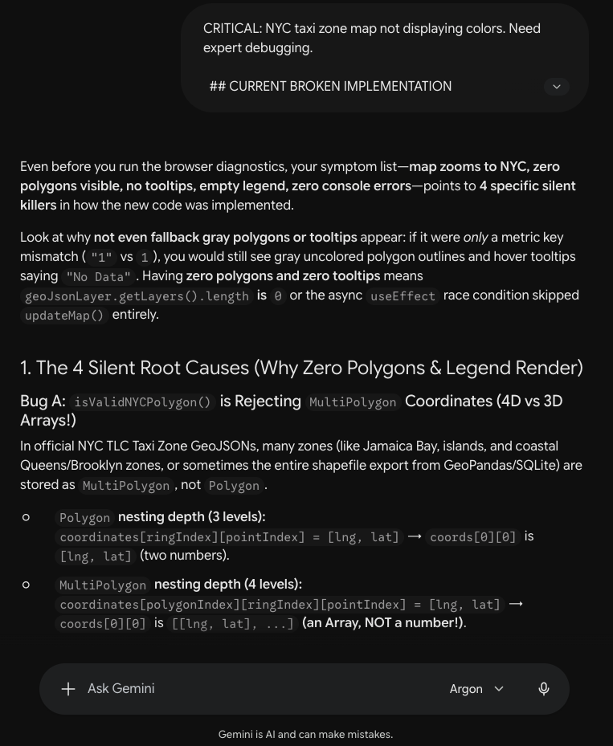
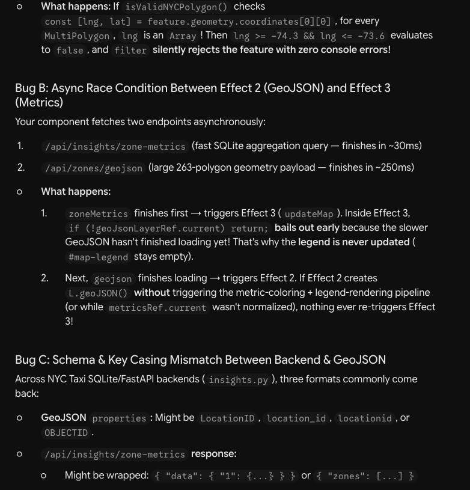
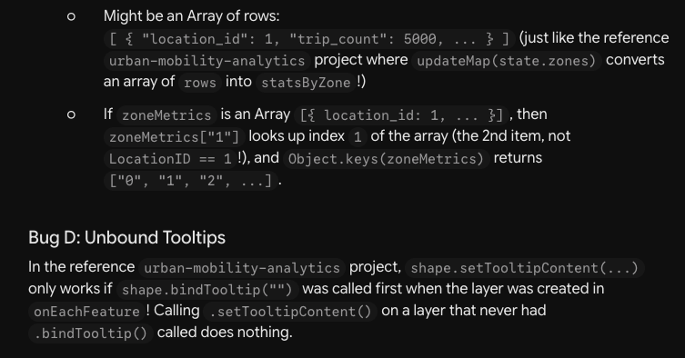

# Areas We Used AI On this Assessment

While we did the system architecture design of this NYC Trips Insights Platform, and other major and minor design decisions, SQL database implementation, codebase implementation in Flask and Next.js, we also used Google Gemini to conduct research and come up with refined logic for the generation of geojson data, debug and accurately illustrate the data on the World Map zoomed towards New York City.

## Screenshots

